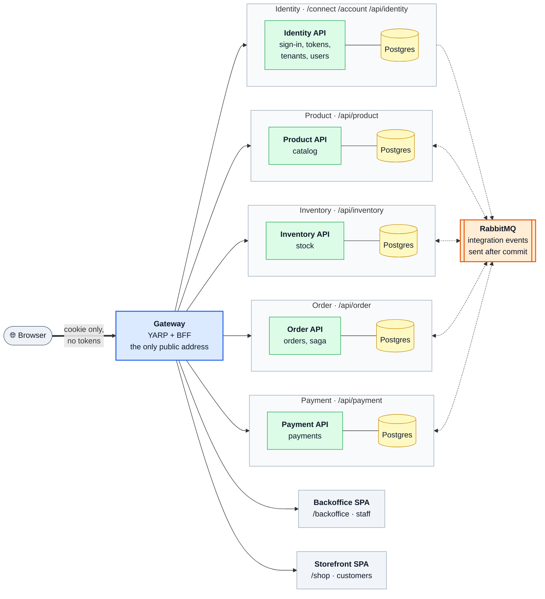

# Inventory and Order

A multi-tenant inventory and order platform built as .NET 10 microservices. Every tenant has its own staff and customers, and every service owns its data, its roles and its permissions. Services talk to each other only through events on RabbitMQ, and the browser talks only to the gateway.

## Architecture



- **Gateway**: the only public address. It signs users in with Identity as a confidential OpenID Connect client and keeps tokens on the server, and forwards the access token to each API. The browser holds only an encrypted, HttpOnly cookie.
- **Identity**: issues short-lived access tokens that carry the user, tenant and user type only. It manages tenants, staff users and its own roles.
- **Each service**: validates the token itself, checks permissions from its own database, and keeps a local copy of the users it needs from Identity's events.
- **Messaging**: every change and its events are saved in one transaction, and events are sent only after commit (transactional outbox).

Built so far: Identity. The gateway, the two SPAs, and the Product, Inventory, Order and Payment services come next.

## Run it locally

### Prerequisites

- Docker Desktop (Compose 2.20 or later)
- .NET SDK 10.0.401 (pinned in `global.json`)
- PowerShell 7

### Start

```powershell
./scripts/restore-feed.ps1 -Service identity
./scripts/dev.ps1 up -Profile infra,apps
```

The first command builds the shared packages Identity depends on into the local feed (`artifacts/packages`). The second builds the images and starts RabbitMQ, the Identity database and Identity, then waits until they are healthy.

### Use

| What | Where |
|---|---|
| Identity sign-in | http://127.0.0.1:5101/account/login |
| Identity discovery document | http://127.0.0.1:5101/.well-known/openid-configuration |
| RabbitMQ management | http://127.0.0.1:15672 |
| Identity database | `127.0.0.1:5401` |

Accounts and passwords for development are in `deploy/dev.env`: the platform admin (`PLATFORM_ADMIN_*`) and the admin of the demo tenant (`DEMO_ADMIN_*`), both created on first start.

### Stop

```powershell
./scripts/dev.ps1 down    # stop, keep data
./scripts/dev.ps1 reset   # stop and delete data
```

### Tests

```powershell
dotnet test src/building-blocks/BuildingBlocks.slnx
dotnet test src/services/identity/Identity.slnx
```

Tests start their own throwaway containers and never touch the dev stack. Docker must be running.

More about the dev stack, ports and settings: [deploy/README.md](deploy/README.md).
